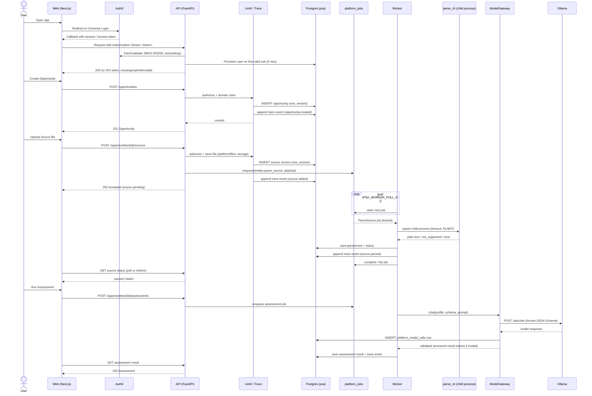

# Pre-Sales Agent — Flow / Sequence Diagram

Covers: sign-in (Auth0), creating an Opportunity, adding a Source (async parse job via the
Postgres job queue and the `worker` process), and an assessment agent call through the
ModelGateway (Ollama).

Source: `backend/app/main_worker.py`, `app/platform/jobs/queue.py`,
`app/modules/intake/application/jobs.py`, `app/platform/model_gateway/`,
`app/platform/uow.py`, `app/platform/trace/`, and the Auth0 flow documented in
`README.md`.
